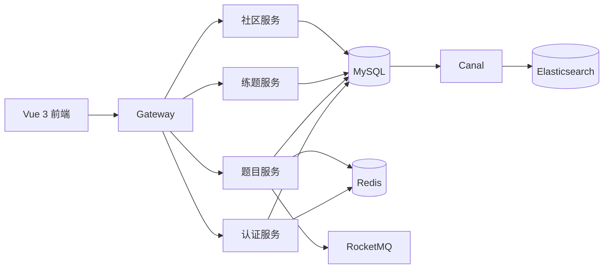

# 面试刷题 Club

一个面向 Java 学习者的刷题和交流项目，包含题库、专项练习、答题记录、社区讨论和后台管理。项目采用微服务架构，前后端都可以通过 Docker Compose 在本地启动。

本地入口：`http://localhost:8088`

- 管理员：`club-admin / Club@123`
- 普通用户：`club-user / Club@123`

以上账号只用于本地开发环境。

## 主要功能

- 题目分类、标签和题型管理，支持单选、多选、判断和简答题。
- 按分类、标签和关键词查题，搜索结果支持排序和高亮。
- 根据条件生成专项练习，自动保存答题进度，交卷后生成答题报告。
- 圈子、帖子、评论和多级回复。
- 题目点赞、取消点赞和点赞状态查询。
- 敏感词维护、词库热更新和存量内容复检。
- 中文管理后台和技术指标页面。

## 技术栈

| 部分 | 技术 |
| --- | --- |
| 前端 | Vue 3、TypeScript、Vite |
| 网关 | Spring Cloud Gateway、Sa-Token |
| 后端 | Spring Boot 2.4.2、Spring Cloud、OpenFeign |
| 数据 | MySQL、Redis、Caffeine、Elasticsearch |
| 消息与同步 | RocketMQ、Canal、XXL-JOB |
| 服务治理 | Nacos、Resilience4j、Micrometer |
| 工程化 | Flyway、Docker Compose、JUnit 5 |

## 项目结构

```text
dyh-club-web/                 中文前端
dyh-club-gateway/             API 网关
dyh-club-runtime-services/    认证、题目、练题、社区四个运行时服务
dyh-club-platform/            公共业务实现和数据库迁移
dyh-club-lock-spring-boot-starter/
                              Redis 分布式锁 Starter
deploy/                       中间件和部署配置
scripts/                      冒烟测试、压测和运维脚本
docs/                         接口、架构和运维文档
```

前端请求统一经过 Gateway，再分别进入认证、题目、练题和社区服务。



## 关键实现

练习生成后会保存固定题单和答题进度，刷新页面可以继续作答。交卷时通过条件更新避免重复判分，不同题型由工厂和策略实现处理。

点赞状态先在 Redis 中更新，再通过 RocketMQ 写回 MySQL。消息按状态版本处理，定时任务负责补偿未完成的记录。

题目详情使用 Caffeine 和 Redis 缓存，数据修改后通过 Redis 通知各实例清理本地缓存。搜索由 Elasticsearch 提供，Canal 负责同步 MySQL 中的题目变化；Elasticsearch 不可用时会回退到基础名称查询。

敏感词词库支持黑白名单和热更新，词库变化后会分批复检已有帖子和评论。

## 本地运行

需要安装 Docker Desktop。第一次运行先复制环境变量示例：

```powershell
Copy-Item .env.example .env
docker compose up -d --build mysql redis auth-service subject-service practice-service circle-service gateway web
docker compose ps
```

容器健康后访问 `http://localhost:8088`。

如果需要同时启动 Nacos、RocketMQ、Elasticsearch 和 Canal：

```powershell
# 在 .env 中开启 ROCKETMQ_ENABLED、ELASTICSEARCH_ENABLED 和 CANAL_ENABLED
docker compose --profile full up -d --build
```

停止服务：

```powershell
docker compose down
```

`docker compose down` 会保留数据卷；需要重新初始化本地数据时可以使用 `docker compose down -v`。

本地 Compose 适合开发和演示。Redis Sentinel、RocketMQ 主从、Nacos 集群和 Elasticsearch 三节点配置放在 [deploy/ha](deploy/ha/README.md)。

## 测试

后端：

```powershell
mvn clean test
```

前端：

```powershell
cd dyh-club-web
npm ci
npm run typecheck
npm run lint
npm run build
npm audit
```

Compose 配置检查：

```powershell
docker compose config --quiet
docker compose --profile full config --quiet
docker compose -f deploy/ha/compose-ha.yaml config --quiet
```

Docker 服务可用时，可以运行完整冒烟脚本：

```powershell
.\scripts\middleware-smoke.ps1
.\scripts\middleware-smoke.ps1 -Full
```

当前测试包含基础业务、四个运行时服务、Gateway 路由、点赞版本处理、缓存、搜索同步和 Sentinel 配置等内容。

## 更多文档

- [接口调用示例](docs/api-testing.md)
- [部署与故障处理](docs/operations.md)
- [测试记录](docs/verification.md)

## 配置说明

- `.env` 不提交到 Git，仓库只保留 `.env.example`。
- 本地默认账号和密码仅供开发使用，其他环境请通过环境变量或配置中心提供配置。
- 数据库结构由 Flyway 管理，迁移文件位于 `dyh-club-platform/src/main/resources/db/migration`。
